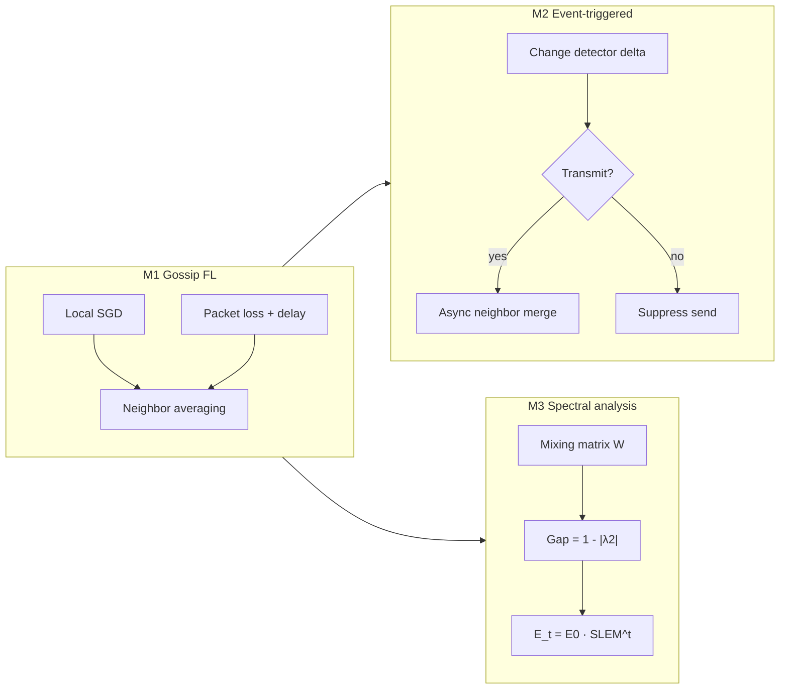

# Decentralized Federated Learning Over Imperfect Channels

Python/PyTorch simulator for **gossip-based decentralized FL** when links drop packets, delay updates, and topologies mix information at different speeds.

This repository implements the three methodologies from the project report. **Training is left to you** — run the commands below on your machine (GPU recommended for M1 and M2). M3 does not train a neural network.

## What each stage does

| Stage | File | Trains a CNN? | Goal |
|-------|------|---------------|------|
| **M1** | `main.py` | Yes | Gossip FL on ring / grid / random graphs under packet loss and optional async delay |
| **M2** | `main_m2.py` | Yes | Event-triggered gossip: send only if \(\\|w(t)-w_{\text{last}}\\|_2 > \delta\) |
| **M3** | `main_m3.py` | No | Mixing-matrix eigenvalues, spectral gap, mixing time, theory vs gossip simulation |



## Setup

```powershell
cd E:\Decentralized_Federated_Learning_Over_Imperfect_Channels
python -m venv venv
.\venv\Scripts\Activate.ps1
pip install -r requirements.txt
```

MNIST downloads automatically into `./data` on first run.

## How you should train

Default sweep (5 clients, 20 rounds, 2 local epochs, IID MNIST, ring+grid+random, packet loss 0.0 and 0.2):

```powershell
python main.py
python main_m2.py
python main_m3.py
```

Or through the wrapper:

```powershell
python run.py m1
python run.py m2
python run.py m3
```

Smaller first run (recommended to check the GPU path):

```powershell
python main.py --topologies ring --packet-loss 0.0 --num-rounds 5 --local-epochs 1
```

Asynchrony and non-IID (report scope; optional extra experiments):

```powershell
python main.py --async-delay 0 2 --packet-loss 0.0 0.2
python main.py --non-iid
```

M2 threshold sweep:

```powershell
python main_m2.py --deltas 0.0 0.05 0.1 --topologies ring --packet-loss 0.0
```

## Plot without training

After JSON files exist under `results/`:

```powershell
python main.py --plot-only
python main_m2.py --plot-only
python main_m3.py --plot-only
# or:
python run.py plots
```

`--plot-only` never starts SGD. M3 never trains even without that flag.

## Shared CLI flags

| Flag | Meaning |
|------|---------|
| `--num-clients` | Virtual devices (default 5) |
| `--num-rounds` | Gossip rounds (default 20) |
| `--local-epochs` | SGD epochs per round (default 2) |
| `--lr` / `--batch-size` / `--seed` | Training / reproducibility |
| `--topologies ring grid random` | Which graphs to sweep |
| `--packet-loss 0.0 0.2` | Drop probabilities |
| `--async-delay 0 2` | Max extra rounds a surviving packet may wait |
| `--non-iid` | Two-shard label partition |
| `--plot-only` | JSON → PNG only |
| `--no-plots` | Train / analyze but skip PNGs |
| `--results-dir` | Output folder (default `./results`) |

## Project layout

| File | Role |
|------|------|
| `config.py` | Hyperparameters + CLI |
| `model.py` | Lightweight MNIST CNN + flatten/unflatten weights |
| `dataset.py` | IID / non-IID MNIST loaders |
| `client.py` | Local SGD (AMP on CUDA) |
| `network.py` | Ring / grid / Erdős–Rényi graphs, Metropolis–Hastings \(W\) |
| `channel.py` | Packet loss, delay buffer, byte accounting |
| `gossip.py` | Always-on neighbor averaging (M1) |
| `gossip_event_triggered.py` | Thresholded transmissions (M2) |
| `metrics.py` | Accuracy, consensus error \(\frac{1}{N}\sum_i \|w_i-\bar w\|^2\), communication plots |
| `spectral_analysis.py` | SLEM, gap, mixing time, scalar gossip simulation (M3) |

## Outputs

- M1: `results/*.json`, `results/m1_all_results.json`, accuracy / consensus / communication PNGs, checkpoints under `results/checkpoints/`
- M2: `results/m2/m2_all_results.json` and comparison PNGs
- M3: `results/m3/m3_spectral_profiles.json`, `results/m3/m3_report.md`, spectral PNGs (plus `m3_m1_validation.png` if M1 JSON exists)

## Metrics

- **Test accuracy / loss** — each client evaluated on the shared MNIST test set
- **Consensus error** — mean squared distance of client weights from the mean weight vector
- **Communication cost** — messages attempted / dropped / delayed and bytes
- **Packet-loss tolerance** — same topology at PLR = 0.0 vs 0.2
- **Spectral gap** — \(1-|\lambda_2(W)|\); larger gap ⇒ faster mixing
